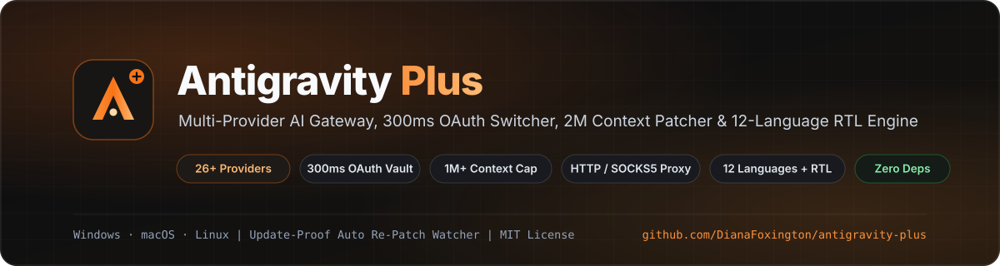
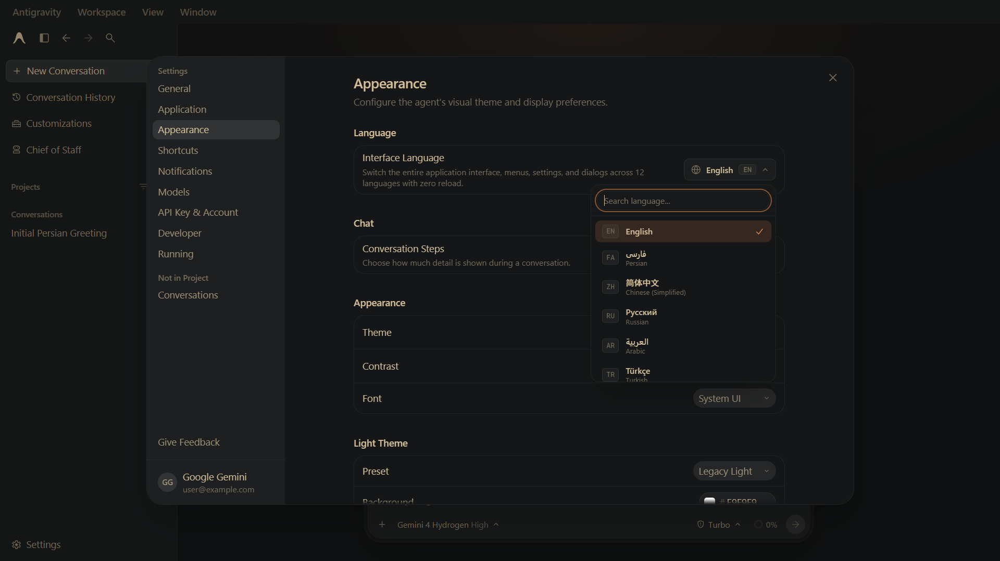
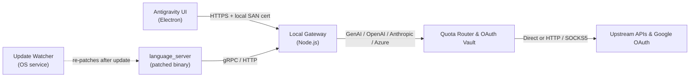

<div align="center">



<br />

[](https://github.com/DianaFoxington/antigravity-plus/actions/workflows/ci.yml)
[](https://github.com/DianaFoxington/antigravity-plus/releases)
[](./README.md#install)
[](./package.json)
[](./LICENSE)

[Install](#install) · [What it changes](#what-it-changes) · [Screenshots](#screenshots) · [How it works](#how-it-works) · [CLI](#cli) · [فارسی](#راهنمای-فارسی)

</div>

---

Stock Antigravity ties you to one Google login, caps context checkpoints at `256K` in `language_server`, hides internal flags behind production checks, and overwrites changes whenever it auto-updates.

**Antigravity Plus** patches the Electron bundle (`app.asar`) and the `language_server` binary in place on your machine. Everything runs locally on Node.js stdlib (`>= 18`), no third-party npm packages, no external binaries bundled, and your keys stay under `~/.gemini/`.

## Install

Requires **Node.js 18+** and **Antigravity Desktop** installed.

**Windows (PowerShell):**
```powershell
irm https://raw.githubusercontent.com/DianaFoxington/antigravity-plus/main/install.ps1 | iex
```

**macOS & Linux:**
```bash
curl -fsSL https://raw.githubusercontent.com/DianaFoxington/antigravity-plus/main/install.sh | bash
```

Or clone and run it yourself:

```bash
git clone https://github.com/DianaFoxington/antigravity-plus.git
cd antigravity-plus

# Windows
.\install.ps1

# macOS / Linux
chmod +x install.sh uninstall.sh && ./install.sh
```

To undo everything and restore the original `app.asar` and `language_server` from backup, run `uninstall.ps1` / `./uninstall.sh` or `node cli.js unpatch`.

---

## What it changes

| Area | Stock | Patched |
| :--- | :--- | :--- |
| Providers | Google login only | 26 presets (OpenAI, Anthropic, Gemini, OpenRouter, DeepSeek, Groq, xAI, Ollama, LM Studio, vLLM, custom endpoints) |
| Account switching | Sign out and log back in | Multi-slot Google OAuth keyring vault + API keys under **Settings -> API Key & Account**, ~300ms switch without reload |
| Context cap | Hardcoded `256K` checkpoint (`0x3E800`) | Byte-pattern binary patch raises the limit in `language_server` (`x64` / `arm64`, auto `codesign` on macOS) to `1M` / `2M` |
| Rate limits (`429`) | Stops until you switch manually | Tracks quota per `(account, model)` pair — moves only that model to the next account/key and keeps the rest where they are |
| Proxy | Needs system VPN / TUN | Built-in `HTTP / HTTPS / SOCKS5` TLS tunnel (with remote DNS) applied to models, OAuth login, and plugin fetches |
| Hidden flags | Disabled in release builds | Unlocks `SetMendelFlagOverrides` (Chief of Staff, Turbo/Auto mode, Battle Mode, Split View, Terminal V2, etc.) |
| Plugins | Marketplace list only | **Install from GitHub** button in Customizations (`SKILL.md`, `plugin.json`, `.mcp.json`, `AGENTS.md`, `.zip`) |
| UI language | English only | Live 12-language switcher (`FA`, `AR`, `ZH`, `RU`, `JA`, `KO`, `DE`, `FR`, `ES`, `PT`, `TR`, `EN`) + RTL/Bidi isolation |
| Stats | Plain context percentage | Live `tok/s`, time-to-first-token (`ms`), session tokens, and rough `$` cost over SSE |
| App updates | Wipes local edits | Background watcher (`Task Scheduler` / `LaunchAgent` / `systemd --user`) re-patches in ~2s after an update |

---

## Screenshots

<table>
  <tr>
    <td align="center" width="50%">
      <strong>API Keys &amp; Providers</strong><br /><br />
      
    </td>
    <td align="center" width="50%">
      <strong>Proxy &amp; Per-Model Quota Rotation</strong><br /><br />
      
    </td>
  </tr>
  <tr>
    <td align="center" width="50%">
      <strong>Language Switcher (Appearance)</strong><br /><br />
      
    </td>
    <td align="center" width="50%">
      <strong>Persian RTL + Bidi</strong><br /><br />
      
    </td>
  </tr>
  <tr>
    <td align="center" colspan="2">
      <strong>Install from GitHub (Customizations)</strong><br /><br />
      
    </td>
  </tr>
</table>

---

## How it works



- On startup, a pure-Node X.509 v3 SAN cert (`~/.gemini/cert.pem`) is generated once so `language_server` trusts the local gateway without `sudo` or OpenSSL.
- `gatewayForwarder.js` translates requests/streams between Google GenAI, OpenAI `/v1/chat/completions`, Anthropic `/v1/messages` (including thinking blocks), and Azure OpenAI.
- For Google OAuth, each added account gets its own saved credential snapshot in `~/.gemini/oauth_profiles/` and swaps directly with the OS keyring instead of going through full sign-out/sign-in.

<details>
<summary>26 included provider presets</summary>

Google Gemini (AI Studio), Google Vertex AI, OpenAI, Anthropic Claude, OpenRouter, DeepSeek, Groq, xAI (Grok), Together AI, Fireworks AI, Mistral AI, Perplexity, Cerebras, SambaNova, HuggingFace, NVIDIA NIM, SiliconFlow, Qwen (DashScope), Zhipu GLM, Moonshot (Kimi), Cohere, Azure OpenAI, Ollama, LM Studio, vLLM, and Custom URLs.

</details>

<details>
<summary>12 UI languages</summary>

`en` English · `fa` فارسی (RTL) · `ar` العربية (RTL) · `zh` 简体中文 · `ru` Русский · `tr` Türkçe · `es` Español · `pt` Português · `ja` 日本語 · `ko` 한국어 · `de` Deutsch · `fr` Français

</details>

---

## CLI

```bash
node cli.js patch                  # patch app + register update watcher
node cli.js status                 # show version, binary offsets, watcher state
node cli.js unpatch                # restore stock files from .bak
node cli.js patch --path "D:\Apps\Antigravity"

node cli.js install-watcher
node cli.js uninstall-watcher
```

## Local files (`~/.gemini/`)

Unpatching does **not** touch anything in `~/.gemini/`:

| Path | What's in it |
| :--- | :--- |
| `~/.gemini/antigravity.json` | Providers, models, context overrides, API keys (JSONC ok) |
| `~/.gemini/antigravity_auth_mode.json` | Current mode (`apikey` / `google_oauth`) and OAuth slots |
| `~/.gemini/oauth_profiles/` | Per-account OAuth snapshots |
| `~/.gemini/antigravity_plus_settings.json` | Proxy URL and quota rotation rules |
| `~/.gemini/cert.pem` & `key.pem` | Localhost TLS cert generated by Node `crypto` |
| `~/.gemini/config/plugins/` | Plugins / skills installed from Marketplace or GitHub |

---

## راهنمای فارسی

آنتی‌گرویتی به صورت پیش‌فرض محدود به یک اکانت گوگل، سقف `256K` کانتکست و کلی فلگ قفل‌شده است و با هر آپدیت هم تمام تغییرات پاک می‌شود. این ابزار فایل‌های برنامه و باینری `language_server` را روی سیستم خودتان پچ می‌کند (بدون نیاز به هیچ پکیج `npm`) و تنظیمات شما در `~/.gemini/` دست‌نخورده می‌ماند.

- **نصب سریع در ویندوز (PowerShell):**
  ```powershell
  irm https://raw.githubusercontent.com/DianaFoxington/antigravity-plus/main/install.ps1 | iex
  ```
- **تنظیمات اکانت و پروایدر:** در **تنظیمات ← کلید API و حساب کاربری** می‌توانید همزمان چند اکانت گوگل (OAuth) و ۲۶ پروایدر API (مثل OpenAI، Anthropic، OpenRouter، DeepSeek، Ollama و...) را اضافه کنید و بدون ری‌لود بینشان جابه‌جا شوید.
- **پروکسی داخلی و چرخش خودکار سهمیه:** در تب **Proxy & Quota Rotation** می‌توانید پروکسی `HTTP/SOCKS5` را مستقیم داخل خود برنامه ست کنید؛ اگر سهمیه یک اکانت روی مدل خاصی تمام شود، فقط همان مدل خودکار به اکانت بعدی می‌رود.
- **زبان فارسی و راست‌چین کامل:** از **تنظیمات ← ظاهر و زبان** زبان را روی فارسی بگذارید تا کل محیط بدون ری‌لود فارسی شود (کلمات انگلیسی هم وسط متن فارسی به‌هم نمی‌ریزند).
- **آپدیت‌های بعدی:** یک واچر سبک در پس‌زمینه ثبت می‌شود که بعد از آپدیت برنامه ظرف چند ثانیه پچ‌ها را دوباره اعمال می‌کند.
- **برگشت به حالت اصلی:** با `.\uninstall.ps1` یا `node cli.js unpatch` همه فایل‌ها از بکاپ برمی‌گردند.

---

[MIT License](./LICENSE)
