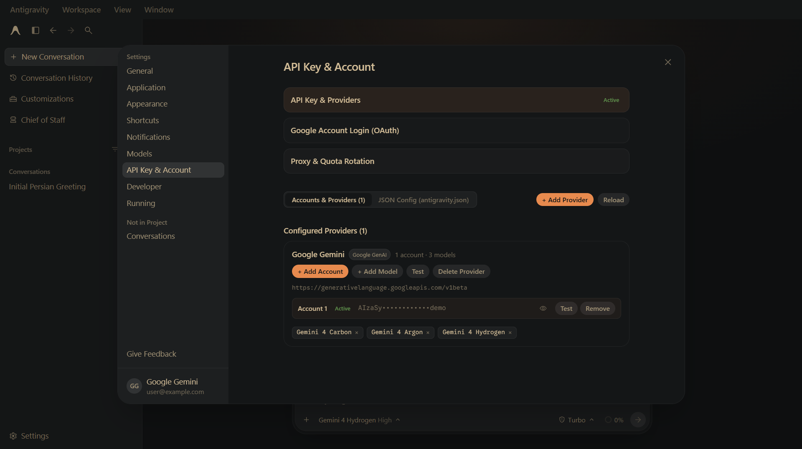
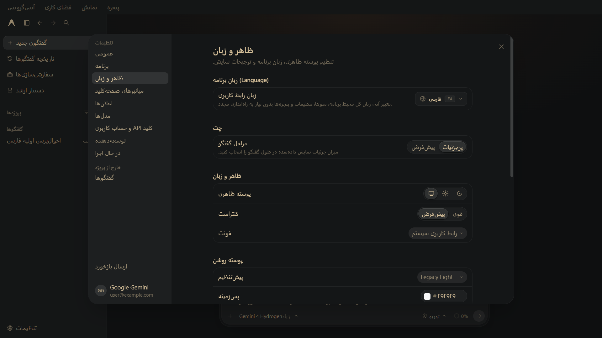
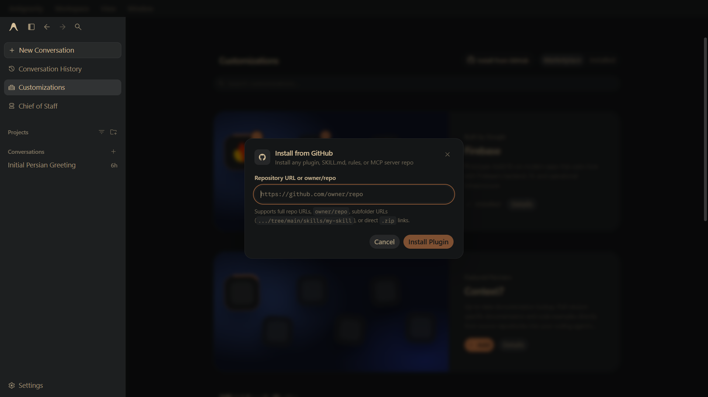

<div align="center">

# Antigravity Plus

**Cross-platform Multi-Provider AI Gateway · ~300ms Google OAuth / API-Key Switcher · 1M+ Context Binary Patcher · Built-in HTTP/SOCKS5 Proxy · 12-Language RTL/Bidi Engine**

[](./README.md#quick-start)
[](./package.json)
[](./package.json)
[](./README.md#screenshots)
[](./LICENSE)

[Key Features](#key-features) · [Screenshots](#screenshots) · [Quick Start](#quick-start) · [CLI Commands](#cli-commands) · [راهنمای فارسی](#راهنمای-فارسی-persian-guide)

</div>

> Zero external npm dependencies. Zero proprietary binaries distributed. Automatically survives future Antigravity Desktop updates.

---

## Screenshots

<table>
  <tr>
    <td align="center" width="50%">
      <strong>Multi-Provider Gateway & Key Vault</strong><br />
      <sub>26 built-in presets, multi-account API keys, & 300ms OAuth switching</sub><br /><br />
      
    </td>
    <td align="center" width="50%">
      <strong>Built-in HTTP/SOCKS5 Proxy & Per-Model Rotation</strong><br />
      <sub>Pure Node TLS tunneling + automatic quota exhaustion failover per (Account, Model)</sub><br /><br />
      
    </td>
  </tr>
  <tr>
    <td align="center" width="50%">
      <strong>12-Language Instant Switcher (Searchable Popover)</strong><br />
      <sub>Switch all menus, settings, and dialogs live with zero app reload</sub><br /><br />
      
    </td>
    <td align="center" width="50%">
      <strong>Full RTL & Unicode Bidi Engine (Persian / Arabic)</strong><br />
      <sub>Automatic RLI/LRI isolation keeps mixed technical terms & metrics clean</sub><br /><br />
      
    </td>
  </tr>
  <tr>
    <td align="center" colspan="2">
      <strong>One-Click Install from GitHub (Customizations)</strong><br />
      <sub>Install any GitHub repo, <code>SKILL.md</code>, rules, or <code>.mcp.json</code> plugin directly into Antigravity</sub><br /><br />
      
    </td>
  </tr>
</table>

---

## Key Features

- **Universal Multi-Provider Gateway (`~/.gemini/antigravity.json`):**
  - Built-in bidirectional streaming & tool-calling translators for **Google GenAI**, **OpenAI-Compatible (`/v1/chat/completions`)**, **Anthropic Messages (`/v1/messages` with Extended Thinking)**, and **Azure OpenAI**.
  - 26 built-in provider presets (Google Gemini, OpenAI, Anthropic, OpenRouter, Groq, DeepSeek, xAI, Together, Fireworks, Mistral, Ollama, LM Studio, vLLM, Perplexity, HuggingFace, and more).
  - Multi-account key rotation per provider with automatic `429` / `503` failover.
- **Instant ~300ms Auth Switcher (`API Key` <-> `Google Account Login OAuth`):**
  - Dedicated two-page settings hub under **Settings -> API Key & Account**.
  - Add & switch between multiple isolated **Google OAuth Accounts** (`~/.gemini/antigravity-google-acc-*`) and **API Key Providers** in ~300ms with **zero page reload**.
- **Native 1M+ Context Window & Live Quota Ring:**
  - Dynamic byte-pattern binary patcher removes the hardcoded `256K` checkpoint cap (`0x3E800` -> `2M`) in `language_server` (`x86_64` & `arm64`) so `1M`+ context models display and utilize their true token limits.
  - Real-time usage & token-per-minute quota bars inside **Settings -> Models**, the **Model Selector (`View Usage`)**, and the **Context Ring Popover**.
- **60+ Hidden Labs & Internal Features Unlocked:**
  - Unlocks `SetMendelFlagOverrides` in production builds (`Chief of Staff`, `Turbo/Auto/Manual` permissions selector, `Battle Mode`, `Split View`, `Built-in Browser`, `File Explorer`, `Terminal V2`, `PDF & Notebook Viewers`, `Thought Editing`, `Conversation Forking`, `Developer Debug Tools`, and more).
- **Per-Model Auto Account Rotation (Google OAuth & API Keys):**
  - Tracks quota exhaustion **per `(Account, Model)` pair**: if `Account 1` runs out of quota on `Claude Sonnet 4.6` or `Gemini 4 Carbon`, it automatically switches to `Account 2` for that model while keeping `Account 1` available for other models that still have quota.
  - Configurable threshold (`<= X%` remaining) & cooldown timer in **Settings -> API Key & Account -> Proxy & Quota Rotation**.
- **Built-in HTTP / HTTPS / SOCKS5 Proxy Engine:**
  - Pure Node.js `HTTP CONNECT` and `SOCKS5` (RFC 1928 / 1929 with remote DNS) TLS tunneling — route AI model requests, Google OAuth sign-in, and plugin downloads through a proxy without enabling system-wide VPN/TUN mode.
- **One-Click Install from GitHub (`Customizations -> + Install from GitHub`):**
  - Paste any GitHub repository, branch, or skill subfolder URL (`https://github.com/owner/repo` or `owner/repo`) to download, normalize (`SKILL.md`, `plugin.json`, `.mcp.json`, `AGENTS.md`), and hot-load into Antigravity in ~300ms.
- **Live Speed (`tok/s`), Latency (`TTFT`), & Session Cost Meter:**
  - Real-time streaming `tok/s`, Time-To-First-Token (`ms`), session token counter, and estimated `$` cost right inside the **Context Ring** and **Settings -> Proxy & Quota Rotation**.
- **12-Language Instant UI Localization + Full RTL / Bidi Engine:**
  - Switch the entire Antigravity interface across **12 languages** (`English`, `فارسی`, `简体中文`, `Русский`, `العربية`, `Türkçe`, `Español`, `Português`, `日本語`, `한국어`, `Deutsch`, `Français`) in **Settings -> Appearance -> Language** with zero reload.
  - Full Unicode Bidirectional (`RLI`/`LRI`) engine & automatic paragraph direction (`dir="auto"`) so mixed RTL + English technical terms never scramble.
- **Auto Re-Patch Watcher (Update-Proof):**
  - Automatically detects when Antigravity is updated (`Windows Task Scheduler`, `macOS LaunchAgent WatchPaths`, or `Linux systemd --user`) and re-applies all patches in ~2 seconds while preserving `~/.gemini/` configs.

---

## Quick Start

### Windows (PowerShell)
```powershell
git clone https://github.com/DianaFoxington/antigravity-plus.git
cd antigravity-plus
.\install.ps1
```

### macOS & Linux
```bash
git clone https://github.com/DianaFoxington/antigravity-plus.git
cd antigravity-plus
chmod +x install.sh uninstall.sh
./install.sh
```

---

## CLI Commands

```bash
# Apply all patches + register background auto-repatch watcher
node cli.js patch

# Check current installation, binary signature offsets, and watcher status
node cli.js status

# Restore original stock Antigravity from backups (preserves ~/.gemini configs)
node cli.js unpatch

# Specify a custom Antigravity path explicitly
node cli.js patch --path "D:\Apps\Antigravity"
```

---

## User Configuration & Privacy

All user keys, custom providers, OAuth slots, and auto-generated localhost TLS certificates stay strictly on your local machine under `~/.gemini/`:

| File | Purpose |
| :--- | :--- |
| `~/.gemini/antigravity.json` | Providers, models, context limits, and multi-account API keys (supports JSONC comments) |
| `~/.gemini/antigravity_auth_mode.json` | Active auth mode (`apikey` or `google_oauth`) and Google OAuth profile slots |
| `~/.gemini/cert.pem` & `key.pem` | Auto-generated local X.509 SAN certificate for `localhost` / `127.0.0.1` (pure Node `crypto`, no OpenSSL required) |
| `~/.gemini/config/plugins/` | Installed Marketplace plugins, skills, and MCP servers |

---

## راهنمای فارسی (Persian Guide)

- **نصب تک‌کلیکی:** در ویندوز کافیست فایل `install.ps1` (یا دستور `node cli.js patch`) و در مک/لینوکس `./install.sh` را اجرا کنید.
- **ضدِ آپدیت خودکار:** با نصب پچ، یک واچر سبک در پس‌زمینه سیستم‌عامل ثبت می‌شود؛ هر زمان نسخه جدید Antigravity را نصب کنید، واچر به صورت خودکار فایل `app.asar` و باینری جدید `language_server` را شناسایی کرده و ظرف ۲ ثانیه تمام قابلیت‌ها را بدون حذف کلیدها یا اکانت‌های `~/.gemini` بازمی‌گرداند.
- **بازگشت به حالت کارخانه:** با اجرای `.\uninstall.ps1` یا `node cli.js unpatch` تمام فایل‌های اصلی برنامه از بکاپ بازگردانی می‌شوند.

---

## License

MIT License — see [LICENSE](./LICENSE).
