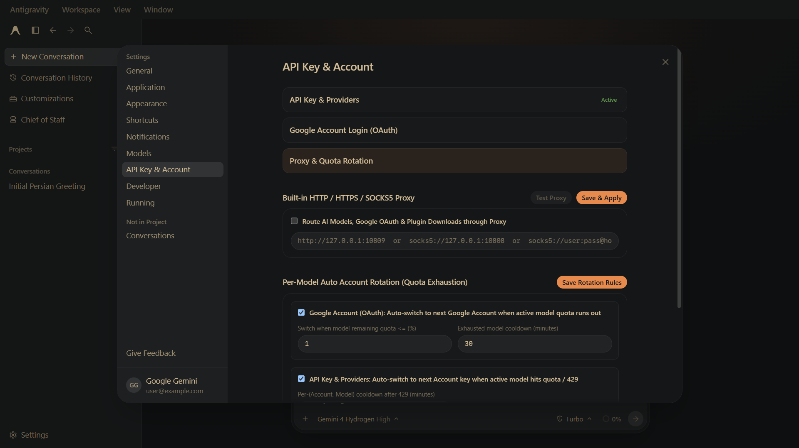
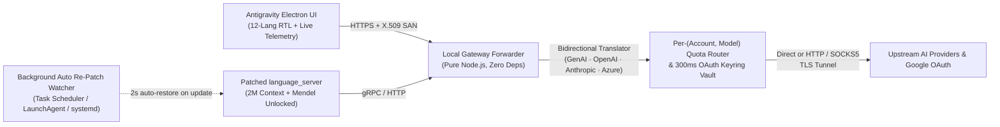

<div align="center">


<br />

[](https://github.com/DianaFoxington/antigravity-plus/actions/workflows/ci.yml)
[](https://github.com/DianaFoxington/antigravity-plus/releases)
[](https://github.com/DianaFoxington/antigravity-plus/stargazers)
[](./README.md#quick-start)
[](./package.json)
[](./README.md#12-language-ui--rtl-engine)
[](./LICENSE)

<br />

[One-Line Install](#quick-start) · [Comparison](#stock-antigravity-vs-antigravity-plus) · [Screenshots](#screenshots) · [Architecture](#architecture) · [CLI](#cli-commands) · [راهنمای فارسی](#راهنمای-فارسی-persian-guide)

</div>

---

## Quick Start

> **Prerequisite:** [Node.js >= 18](https://nodejs.org/) and **Antigravity Desktop** installed. Zero external npm packages required.

### Option A: One-Line Install (Fastest)

**Windows (PowerShell):**
```powershell
irm https://raw.githubusercontent.com/DianaFoxington/antigravity-plus/main/install.ps1 | iex
```

**macOS & Linux:**
```bash
curl -fsSL https://raw.githubusercontent.com/DianaFoxington/antigravity-plus/main/install.sh | bash
```

### Option B: Clone & Run Locally

```bash
git clone https://github.com/DianaFoxington/antigravity-plus.git
cd antigravity-plus

# Windows:
.\install.ps1

# macOS & Linux:
chmod +x install.sh uninstall.sh && ./install.sh
```

---

## Stock Antigravity vs. Antigravity Plus

| Feature | Stock Antigravity | Antigravity Plus |
| :--- | :--- | :--- |
| **Model Providers** | Official Google login only | **26+ built-in presets** (Gemini, OpenAI, Anthropic, OpenRouter, DeepSeek, Groq, xAI, Ollama, LM Studio, vLLM, Custom) |
| **Auth Switching** | Single account, manual sign-out | **~300ms zero-reload switcher** between multi-slot **Google OAuth Vault** & **API Keys** |
| **Context Window Cap** | Hardcoded `256K` checkpoint limit | **Dynamic binary patch (`2M` / `1M` native limit)** in `language_server` (`x64` & `arm64`) |
| **Quota Exhaustion** | Manual account switching on `429` | **Per-`(Account, Model)` auto-rotation** with configurable threshold & cooldown |
| **Proxy / Tunneling** | System VPN / TUN required | **Built-in pure Node `HTTP / HTTPS / SOCKS5`** TLS tunnel with remote DNS |
| **Hidden Labs & Modes** | Locked in production (`Mendel` off) | **60+ unlocked flags** (`Chief of Staff`, `Turbo/Auto`, `Battle Mode`, `Split View`, `Terminal V2`, etc.) |
| **Plugin Installation** | Curated marketplace only | **One-click `Install from GitHub`** (`SKILL.md`, `plugin.json`, `.mcp.json`, `AGENTS.md`) |
| **UI Languages** | English only | **12 languages instant switch** + **Unicode RTL/Bidi engine** (`FA`, `AR`, `ZH`, `RU`, `JA`, `KO`, `DE`, `FR`, `ES`, `PT`, `TR`, `EN`) |
| **Telemetry** | Static percentage ring | **Live SSE `tok/s`, `TTFT (ms)`, session tokens & `$` cost meter** |
| **App Updates** | Wipes custom modifications | **Auto Re-Patch Watcher** restores everything in ~2s after every update |

---

## Screenshots

<table>
  <tr>
    <td align="center" width="50%">
      <strong>Multi-Provider Gateway & Key Vault</strong><br />
      <sub>26 built-in presets, multi-account API keys, & 300ms OAuth switching</sub><br /><br />
      
    </td>
    <td align="center" width="50%">
      <strong>Built-in HTTP/SOCKS5 Proxy & Per-Model Rotation</strong><br />
      <sub>Pure Node TLS tunneling + automatic quota exhaustion failover per (Account, Model)</sub><br /><br />
      
    </td>
  </tr>
  <tr>
    <td align="center" width="50%">
      <strong>12-Language Instant Switcher (Searchable Popover)</strong><br />
      <sub>Switch all menus, settings, and dialogs live with zero app reload</sub><br /><br />
      
    </td>
    <td align="center" width="50%">
      <strong>Full RTL & Unicode Bidi Engine (Persian / Arabic)</strong><br />
      <sub>Automatic RLI/LRI isolation keeps mixed technical terms & metrics clean</sub><br /><br />
      
    </td>
  </tr>
  <tr>
    <td align="center" colspan="2">
      <strong>One-Click Install from GitHub (Customizations)</strong><br />
      <sub>Install any GitHub repo, <code>SKILL.md</code>, rules, or <code>.mcp.json</code> plugin directly into Antigravity</sub><br /><br />
      
    </td>
  </tr>
</table>

---

## Architecture



---

## Supported Providers & Languages

<details>
<summary><strong>26 Built-in Provider Presets & Protocols</strong></summary>

- **Google GenAI:** Google Gemini (AI Studio), Google Vertex AI
- **OpenAI Compatible:** OpenAI, OpenRouter, DeepSeek, Groq, xAI (Grok), Together AI, Fireworks AI, Mistral AI, Perplexity, Cerebras, SambaNova, HuggingFace, NVIDIA NIM, SiliconFlow, Qwen (DashScope), Zhipu GLM, Moonshot (Kimi), Cohere
- **Anthropic Messages (with Extended Thinking):** Anthropic Claude, AWS Bedrock / Custom Anthropic Endpoints
- **Azure & Local Runtimes:** Azure OpenAI, Ollama, LM Studio, vLLM, Custom OpenAI/Anthropic/GenAI URL

</details>

<details id="12-language-ui--rtl-engine">
<summary><strong>12 Supported UI Languages (Zero-Reload + RTL/Bidi)</strong></summary>

| Code | Language | Direction | Code | Language | Direction |
| :--- | :--- | :--- | :--- | :--- | :--- |
| `en` | English | LTR | `es` | Español | LTR |
| `fa` | فارسی (Persian) | **RTL + Bidi** | `pt` | Português | LTR |
| `ar` | العربية (Arabic) | **RTL + Bidi** | `ja` | 日本語 (Japanese) | LTR |
| `zh` | 简体中文 (Chinese) | LTR | `ko` | 한국어 (Korean) | LTR |
| `ru` | Русский (Russian) | LTR | `de` | Deutsch | LTR |
| `tr` | Türkçe (Turkish) | LTR | `fr` | Français | LTR |

</details>

---

## CLI Commands

```bash
# Apply all JS + binary patches and register the update-proof watcher
node cli.js patch

# Inspect current installation, binary signature offsets, and watcher health
node cli.js status

# Restore original stock Antigravity from backups (preserves ~/.gemini configs)
node cli.js unpatch

# Target a non-default Antigravity installation directory
node cli.js patch --path "D:\Apps\Antigravity"

# Manage the background watcher manually
node cli.js install-watcher
node cli.js uninstall-watcher
```

---

## User Configuration & Privacy

All API keys, custom providers, OAuth keyring slots, and auto-generated localhost TLS certificates remain strictly on your local machine under `~/.gemini/`:

| File / Directory | Purpose |
| :--- | :--- |
| `~/.gemini/antigravity.json` | Providers, custom models, context limits, and multi-account API keys (JSONC supported) |
| `~/.gemini/antigravity_auth_mode.json` | Active auth mode (`apikey` or `google_oauth`) and OAuth account slots |
| `~/.gemini/oauth_profiles/` | Isolated per-account Google OAuth credential snapshots synced with OS keyring |
| `~/.gemini/antigravity_plus_settings.json` | Built-in HTTP/SOCKS5 proxy settings and per-model quota rotation rules |
| `~/.gemini/cert.pem` & `key.pem` | Auto-generated X.509 v3 SAN certificate for `localhost` / `127.0.0.1` (pure Node `crypto`) |
| `~/.gemini/config/plugins/` | Installed Marketplace and GitHub-imported plugins, skills, and MCP servers |

---

## راهنمای فارسی (Persian Guide)

- **نصب یک‌خطی (بدون نیاز به کلون دستی):**
  در پاورشل ویندوز دستور زیر را اجرا کنید:
  ```powershell
  irm https://raw.githubusercontent.com/DianaFoxington/antigravity-plus/main/install.ps1 | iex
  ```
- **نصب و راه‌اندازی دستی:** فایل `install.ps1` در ویندوز یا `./install.sh` در مک و لینوکس تمام پچ‌های JS و باینری `language_server` را بدون نیاز به هیچ پکیج خارجی اعمال می‌کند.
- **سوئیچ آنی ۳۰۰ میلی‌ثانیه‌ای بین اکانت‌ها:** در مسیر **تنظیمات ← کلید API و حساب کاربری** می‌توانید همزمان بین چندین اکانت گوگل (OAuth) و ۲۶ پروایدر API (مثل OpenAI، Anthropic، OpenRouter، DeepSeek، Ollama و...) بدون ری‌لود جابه‌جا شوید.
- **پروکسی داخلی و چرخش خودکار سهمیه:** در تب **Proxy & Quota Rotation** می‌توانید پروکسی `HTTP/SOCKS5` را مستقیم درون برنامه ست کنید و چرخش خودکار اکانت به ازای هر مدل را فعال نگه دارید.
- **بومی‌سازی ۱۲ زبانه با پشتیبانی کامل فارسی (RTL/Bidi):** از **تنظیمات ← ظاهر و زبان ← زبان رابط کاربری** زبان فارسی را انتخاب کنید تا کل منوها و چت با ایزولاسیون صحیح کلمات انگلیسی راست‌به‌چپ شوند.
- **ضدِ آپدیت خودکار:** پس از هر آپدیت Antigravity، واچر پس‌زمینه ظرف ~۲ ثانیه نسخه جدید را شناسایی و بدون حذف تنظیمات `~/.gemini/` مجدداً پچ می‌کند.
- **بازگشت به حالت کارخانه:** با `.\uninstall.ps1` یا `node cli.js unpatch` همه فایل‌های اصلی از بکاپ بازگردانی می‌شوند.

---

## License

MIT License — see [LICENSE](./LICENSE).
